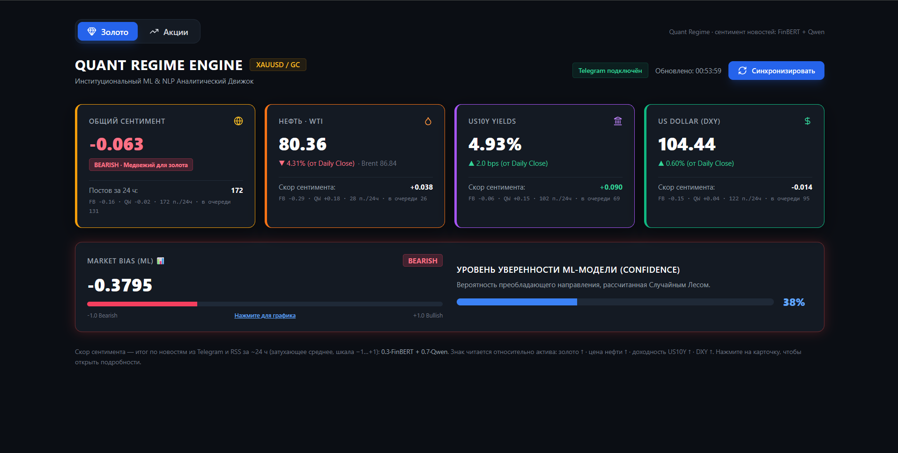
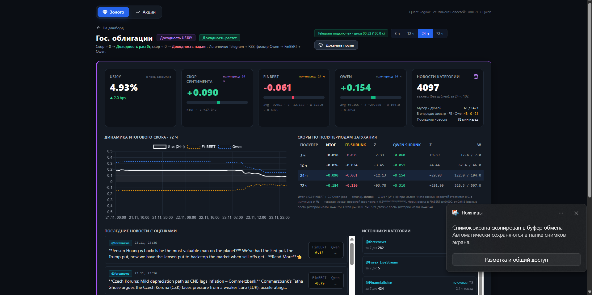
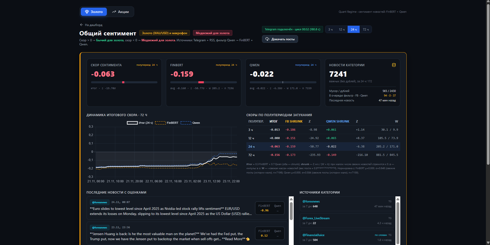

# Quant Regime Engine

**Институциональный аналитический движок рыночного сентимента и макро-режимов** на базе ансамбля нейросетей (**FinBERT + Qwen 2.5**) с асинхронным сбором новостей из Telegram и RSS, экспоненциальным взвешиванием по времени и модулем статистической валидации сигналов.


---

## Обзор интерфейса

> *Ниже приведены скриншоты основных экранов дашборда (поместите ваши изображения в папку `docs/` перед публикацией).*

| Главный дашборд: Золото (XAU/USD) и макрофон | Свинг-аналитика по акциям США |
| :---: | :---: |
|  |  |

| Детализация категории: динамика сентимента и разбор новостей |
| :---: |
|  |

---

## Ключевые возможности

1. **Мульти-активный охват (Macro & US Equities):**
   * **Макро-блок и сырьё:** Общий сентимент золота (`XAU/USD`), нефть (`WTI` / `Brent`), доходность 10-летних казначейских облигаций США (`US10Y`) и индекс доллара (`DXY`).
   * **Акции США (свинг-горизонт 3–10 дней):** Индексный фон (`S&P 500` / `Nasdaq` / `VIX`) и отдельные тикеры мега-кэпов (`NVDA`, `MSFT`, `AAPL`, `AMZN`, `GOOGL`, `JPM`, `XOM`, `LLY`) с отслеживанием ближайших дат квартальной отчётности (риск гэпа).
2. **Двухэтапный NLP-конвейер (Gatekeeper + Ensemble):**
   * **Этап 1 — Фильтрация шума (Qwen Judge):** Отдельные классификаторы важности (`1` / `0`) для макро-рынка и для корпоративных новостей отсекают рекламу, спам и нерелевантный шум.
   * **Этап 2 — Ансамблевый скоринг:**
     * **FinBERT (`ProsusAI/finbert`):** Локальный инференс на PyTorch (CUDA/CPU) оценивает базовую тональность англоязычных финансовых текстов ($p_{\text{pos}} - p_{\text{neg}}$).
     * **Qwen 2.5 (`qwen2.5:7b` через Ollama):** Выступает в роли доменного аналитика. Вместо парсинга свободного текста система запрашивает `top_logprobs` первого токена ответа (`U` — рост актива, `D` — падение, `N` — нейтрально) и восстанавливает калиброванное распределение вероятностей.
3. **Интерактивный веб-терминал:**
   * Дашборд на **FastAPI + Tailwind CSS + Chart.js** с переключением полупериодов затухания, живыми котировками через `yfinance`, прозрачной разбивкой оценок по каждому посту и мониторингом состояния воркеров.

---

## Архитектура конвейера

```text
[Telegram Channels (Telethon)]   [RSS Feeds (httpx + feedparser)]
               │                                 │
               └────────────────┬────────────────┘
                                ▼
        ┌───────────────────────────────────────────────┐
        │   Очистка текста, языковой фильтр (RU/EN),    │
        │   маршрутизация по тикерам и дедупликация     │
        └───────────────────────┬───────────────────────┘
                                ▼
        ┌───────────────────────────────────────────────┐
        │   Этап 1: Qwen Judge (фильтр важности 1 / 0)  │
        └───────────────────────┬───────────────────────┘
                                ▼
               ┌────────────────┴────────────────┐
               ▼                                 ▼
   [FinBERT (PyTorch, EN)]          [Qwen 2.5 Logprobs (U/D/N)]
               │                                 │
               └────────────────┬────────────────┘
                                ▼
        ┌───────────────────────────────────────────────┐
        │  Point-in-Time агрегация (SQLite WAL)         │
        │  Экспоненциальное затухание + Shrinkage + Z   │
        └───────────────────────┬───────────────────────┘
                                ▼
               [FastAPI REST API & Web Dashboard]
```

---

## Математическая модель и валидация

### 1. Калибровка вероятностей LLM через Logprobs
Для каждой категории (золото, нефть, доходность `US10Y`, `DXY`, конкретный тикер) модель Qwen получает специализированный системный промпт с учётом рыночной механики (например, рост ставок ФРС оценивается как бычий сигнал для `DXY` и `US10Y`, но медвежий для золота). Из `top_logprobs` первого сгенерированного токена суммируются вероятности вариантов токенов для классов $U$, $D$, $N$:

$$S_{\text{Qwen}} = p(U) - p(D) \in [-1.0, +1.0]$$

Итоговый скор новости формируется как взвешенный ансамбль:

$$S = w_{\text{FB}} \cdot S_{\text{FinBERT}} + (1 - w_{\text{FB}}) \cdot S_{\text{Qwen}}$$

где $w_{\text{FB}} = 0.3$ для макро-активов и $w_{\text{FB}} = 0.4$ для корпоративных новостей акций США (для русскоязычных источников FinBERT автоматически пропускается, и расчёт идёт исключительно по Qwen).

### 2. Агрегация с экспоненциальным затуханием и регуляризацией
На любой момент времени $t_{\text{asof}}$ в расчёт попадают строго те новости, которые опубликованы не позднее $t_{\text{asof}}$ (исключение *look-ahead bias*). Вес каждой новости убывает экспоненциально в зависимости от её возраста $\Delta t_i$ и выбранного полупериода $H \in \{3, 12, 24, 72, 120\}$ часов:

$$w_i = 2^{-\Delta t_i / H}, \qquad W = \sum_{i} w_i$$

Чтобы единичная случайная новость в период информационного затишья не давала экстремальных значений $\pm 1.0$, применяется байесовское стягивание (*shrinkage*) к нулю с параметром $k$ псевдо-нейтральных постов:

$$\text{Score}_{\text{shrunk}}(t_{\text{asof}}) = \frac{\sum_{i} w_i \cdot S_i}{W + k}$$

Дополнительно рассчитывается нормированный импульс ($z$-score) относительно исторического среднего $\mu$ и стандартного отклонения $\sigma$:

$$z(t_{\text{asof}}) = \frac{\sum_{i} w_i \cdot (S_i - \mu)}{\sigma}$$

### 3. Бэктестинг и статистическая проверка (`scripts/validate_scores.py`)
В проект включён исследовательский скрипт для проверки предсказательной силы скоров на реальных часовых барах (`yfinance` или пользовательский CSV):
* **Строгий Point-in-Time:** цена актива фиксируется только после закрытия часового бара, исключая заглядывание в будущее.
* **Метрики качества:** ранговая корреляция Спирмена (**Information Coefficient, IC**) между значением скора и форвардной доходностью через $H \in \{6, 24, 72\}$ часов, доля верных направлений (`hit%`) и спред доходностей (в б.п.) между бычьими и медвежьими сигналами.
* **Блочный бутстрэп (Block Bootstrap):** построение 95% доверительных интервалов для IC с учётом автокорреляции перекрывающихся временных окон.

---

## Инженерные особенности

* **Асинхронность и изоляция сбоев:** Сбор Telegram, опрос RSS (с ограничением одновременных запросов через `asyncio.Semaphore`), инференс FinBERT (в отдельном потоке под `threading.Lock`) и запросы к Ollama развязаны. Падение одного источника или локальной LLM не останавливает работу дашборда.
* **Умная дедупликация для акций:** Если одна и та же новость приходит из нескольких лент (например, `Yahoo Finance` и `Google News` по разным тикерам), дубликат помечается флагом `is_dup = 1`, но его привязки к тикерам переносятся на самый ранний оригинал — ни одна акция не теряет релевантную новость, а Qwen не тратит ресурсы на повторный прогон.
* **Конкурентная работа с SQLite:** База данных работает в режиме `WAL` (`Write-Ahead Logging`), что позволяет фоновому конвейеру записывать батчи оценок параллельно с чтением данных веб-интерфейсом.
* **Покрытие тестами:** Модуль `scripts/selftest.py` проверяет маршрутизацию заголовков, перенос категорий при дедупликации, разделение судей для золота и акций, обработку кириллицы и математику агрегации на изолированной временной БД без доступа к сети и GPU.

> **Примечание о публичной версии:** В целях соблюдения информационной безопасности и защиты интеллектуальной собственности в публичном репозитории исключены пользовательские сессии Telegram (`*.session`), локальные базы данных (`*.db`), обученные веса калиброванного случайного леса (в коде предусмотрен автоматический fallback) и детальные торговые промпты заменены на демонстрационные шаблоны.

---

## Структура проекта

```text
├── app/
│   ├── main.py                  # FastAPI приложение, HTML-роуты и REST API
│   ├── config.py                # Конфигурация конвейера через переменные окружения
│   ├── categories.py            # Определение категорий, полупериодов и фильтров
│   ├── sources.py               # Реестр Telegram-каналов и RSS-лент
│   ├── stocks.py                # Вселенная тикеров США и отраслевые драйверы
│   ├── collector/
│   │   ├── macro_fetcher.py     # Загрузка рыночных котировок и дат отчётности (yfinance)
│   │   ├── rss_ingest.py        # Асинхронный парсер RSS-лент
│   │   └── rss_parser.py        # Пайплайн для модели Market Bias
│   ├── model/
│   │   ├── finbert_model.py     # Потокобезопасная обёртка над ProsusAI/finbert
│   │   └── qwen_analyst.py      # Валидатор контекста через Ollama API
│   ├── scoring/
│   │   ├── pipeline.py          # Оркестратор фонового цикла (Fetch -> Judge -> Score -> Agg)
│   │   ├── scorer.py            # Инференс FinBERT и извлечение logprobs из Qwen
│   │   ├── prompts.py           # Системные промпты по классам активов
│   │   ├── aggregate.py         # Чистая математика затухания, shrinkage и z-score
│   │   ├── service.py           # Сборка аналитических срезов и временных рядов
│   │   └── text_clean.py        # Нормализация текста, ключи дублей и детектор кириллицы
│   ├── storage/
│   │   ├── db.py                # Подключение к SQLite (WAL) и базовые таблицы
│   │   └── posts_db.py          # Хранилище постов, связей M:N с категориями и журнала скоров
│   └── templates/               # Адаптивный UI (index.html, stocks.html, category.html)
├── scripts/
│   ├── selftest.py              # Офлайн-тестирование логики, маршрутизации и математики
│   ├── validate_scores.py       # Статистическая валидация скоров (IC, Block Bootstrap)
│   ├── check_sources.py         # Диагностика RSS и анализ качества Telegram-каналов
│   ├── run_cycle_once.py        # Ручной запуск одного цикла конвейера
│   ├── tg_login.py              # CLI-скрипт авторизации сессии Telethon
│   └── watch_queue.py           # Мониторинг очередей обработки в реальном времени
└── check_system.py              # Проверка инициализации БД и маршрутов API
```

---

## Быстрый запуск и проверка

### 1. Установка зависимостей
```bash
git clone https://github.com/<ваш_ник>/quant-regime-engine.git
cd quant-regime-engine

python -m venv .venv
# Windows:
.venv\Scripts\activate
# Linux / macOS:
source .venv/bin/activate

pip install -r requirements.txt
```

### 2. Запуск офлайн-тестов (не требует GPU, Ollama и интернета)
Убедитесь, что логика маршрутизации, дедупликации и агрегации работает корректно:
```bash
python scripts/selftest.py
```

### 3. Запуск веб-дашборда
Дашборд можно запустить даже без настроенного Telegram и Ollama (в режиме отображения рыночных котировок и интерфейса):
```bash
# Отключаем фоновый сбор Telegram, если не заданы ключи API:
# Windows (PowerShell): $env:TG_ENABLED="0"; $env:PIPELINE_ENABLED="0"
# Linux / macOS: export TG_ENABLED=0 PIPELINE_ENABLED=0

uvicorn app.main:app --reload
```
После запуска интерфейс доступен по адресу: `http://127.0.0.1:8000`

### 4. Полный режим (с локальной LLM и Telegram)
1. Установите [Ollama](https://ollama.com/) и загрузите модель:
   ```bash
   ollama pull qwen2.5:7b
   ```
2. Укажите креды Telegram API и выполните вход:
   ```bash
   export TG_API_ID="ваш_api_id"
   export TG_API_HASH="ваш_api_hash"
   python scripts/tg_login.py
   ```
3. Запустите сервер `uvicorn app.main:app` — фоновый воркер автоматически начнёт сбор и оценку новостей.